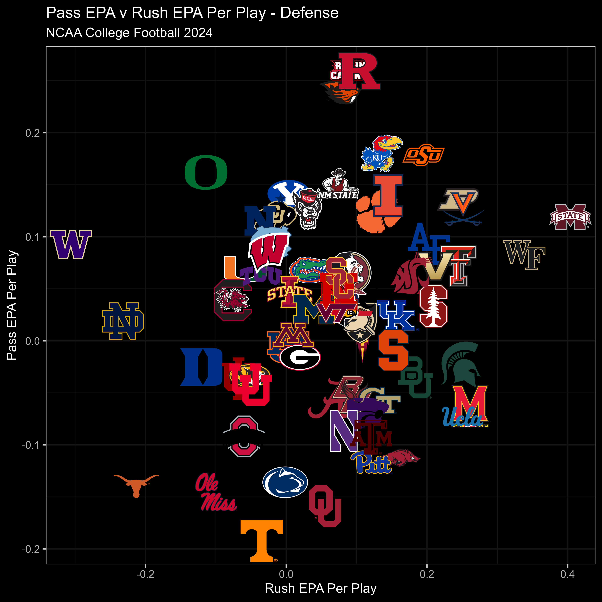

# Predicting the 2024 College Football Playoff

A team project that used 2024 college football play-by-play data to predict every game of the first 12-team College Football Playoff. An XGBoost model was built on EPA differential, win probability, and a Gini concentration index, then adjusted with team health factors.

## The question

The 2024 season introduced the first 12-team CFP, with campus games, first-round byes, and a much wider mix of teams and play styles than the old four-team format. The project asked: can a model built on play-level efficiency metrics predict the winner of each matchup and the eventual national champion? Factors that are usually treated as unquantifiable, such as injuries and reliance on a few explosive players, were turned into model inputs.

## Data

- **Source:** 2024 FBS play-by-play data from [cfbfastR](https://cfbfastR.sportsdataverse.org/) (SportsDataverse)
- **Time span:** 2024 regular season, weeks 1-15. The Gini component uses weeks 10-15 for the 12 playoff teams.
- **Supplementary:** injury reports and depth charts (for example Ourlads, USA Today) used to set team health factors

## Approach

- **Features:** offensive minus defensive EPA (EPA differential), mean WPA-based win probability, and a Gini index measuring how unevenly EPA and WPA are spread across plays for the favored team in each matchup. Non-playoff teams were assigned a neutral Gini value of 0.5.
- **Model:** XGBoost binary classifier (win/loss), trained on an 80/20 train-test split.
- **Tuning:** grid search over nrounds, max depth, eta, gamma, column and row subsampling, and min child weight, evaluated with 5-fold cross-validation.
- **Post-model adjustments:** a hand-set health factor (0-1) multiplied each team's win probability (for example, Georgia was discounted after QB Carson Beck's elbow injury), plus an upset/variance term for close EPA matchups.
- **Bracket simulation:** the team with an adjusted win probability above 0.5 advanced, round by round, until a champion was produced.

## Key findings

- The tuned XGBoost model reached **81.23% accuracy** (reported as training accuracy).
- Best parameters from cross-validation: nrounds 150, eta 0.2, max depth 3, gamma 1, colsample 0.8, min child weight 5, subsample 0.8.
- **Predicted champion: Oregon**, beating Notre Dame in the title game with a predicted win probability of 52%.
- Predicted semifinals: Notre Dame over Boise State (85%) and Oregon over Arizona State (78%).
- Predicted quarterfinal upsets included Notre Dame over Georgia (71%) and Arizona State over Texas (76%). Georgia's probability was cut the most by the injury adjustment.

  

*Defensive pass EPA vs rush EPA per play allowed, 2024 FBS teams.*

## Tools

- **R** with R Markdown
- `cfbfastR` (play-by-play data), `xgboost`, `caret` (partitioning, tuning, random forest baseline)
- `dplyr`, `tidyverse`, `data.table`, `stringr`
- `Gini`, `ineq` (Gini coefficients)
- `ggplot2`, `ggdark`, `ggimage`, `ggrepel`, `ggridges`, `reshape` (visualization)

## Repository contents

| Path | Description |
| --- | --- |
| [`Grow Irish CFP.Rmd`](Grow%20Irish%20CFP.Rmd) | Main XGBoost pipeline: EPA aggregation, model training, injury and upset adjustments, round-by-round bracket predictions |
| [`CFPGini.Rmd`](CFPGini.Rmd) | Gini index of EPA and WPA concentration for playoff teams, weeks 10-15 |
| [`CFP Predict.Rmd`](CFP%20Predict.Rmd) | Early exploratory random forest model (caret) on playoff-team play-by-play data |
| [`docs/CFP Predictions Report.pdf`](docs/CFP%20Predictions%20Report.pdf) | Written report: background, methods, tuning results, and full bracket predictions |
| [`docs/CFP Prediction Slides.pdf`](docs/CFP%20Prediction%20Slides.pdf) | Presentation slides, "The Data Bowl: Predicting the 2025 CFP National Champion with Analytics" |
| [`docs/epa_per_play_def_2024.jpeg`](docs/epa_per_play_def_2024.jpeg) | Chart of defensive pass vs rush EPA per play, 2024 season |

## Notes

- The R Markdown files load data from local absolute paths (for example `C:/Users/...`). Update these paths, or pull data directly with `cfbfastR::load_cfb_pbp(seasons = 2024)`, before running.
- Group project by Jesse Davila, Collin Travasos, Molly McCann, Josh Garzaniti, and Tyler Seroczynski (Notre Dame MSBA, sports analytics).
